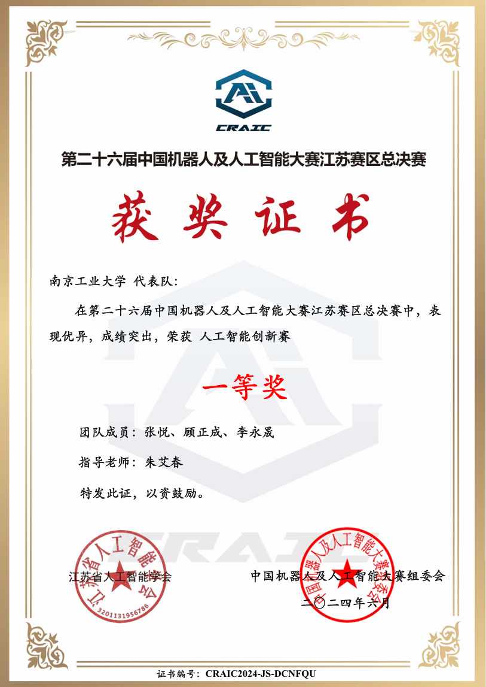
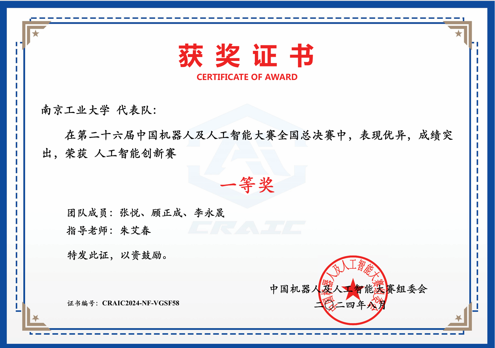
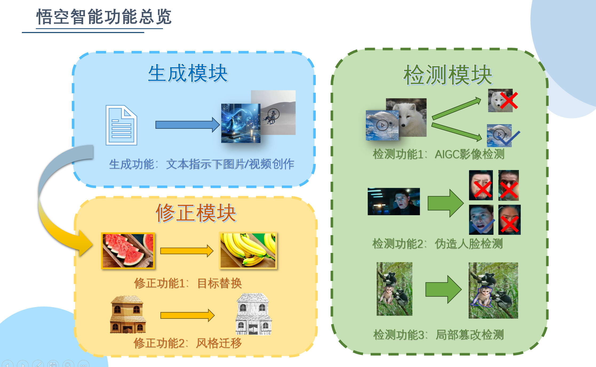
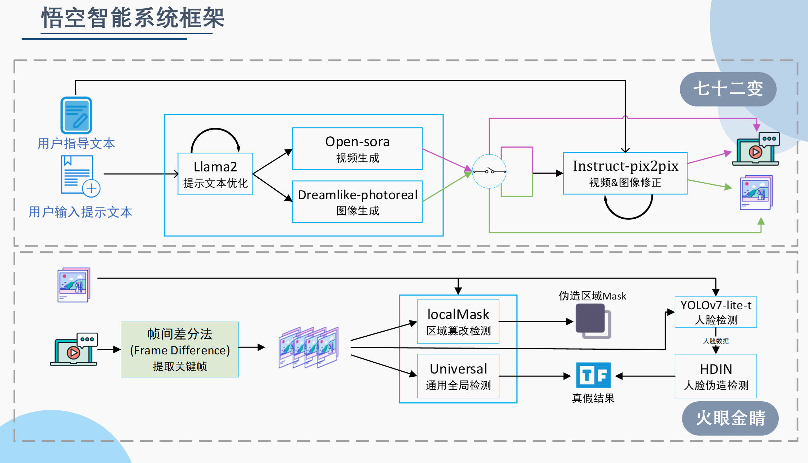
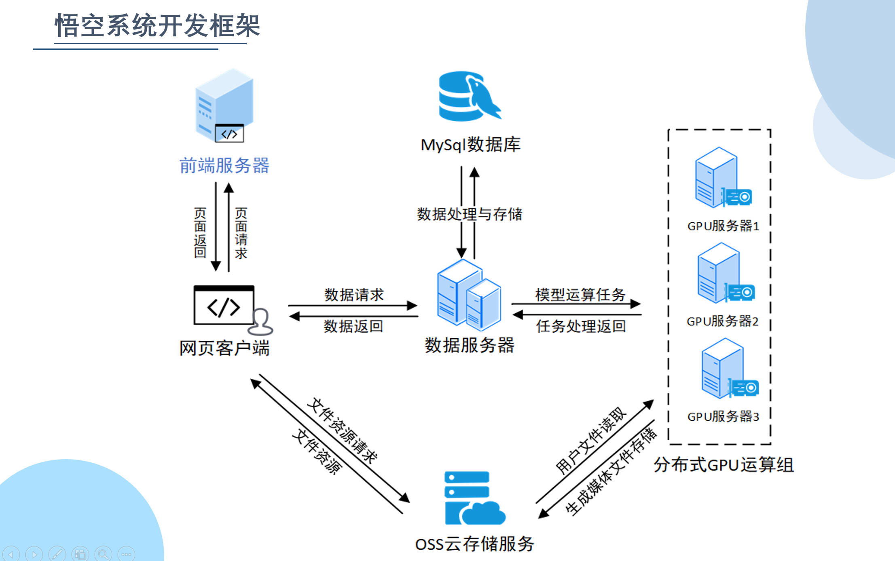

# 项目简介

**悟空智能**是包含“七十二变”（生成）和“火眼金睛”（检测）两个模块的综合系统，生成模块提供文本指示下的影像创作、目标替换和风格迁移。检测模块提供了对多种伪造类型的检测，包括“七十二变”生成、PS 篡改和人脸伪造，提供网络信息安全保障。

该项目荣获：

- 第二十六届中国机器人及人工智能大赛江苏赛区省级一等奖
  
- 第二十六届中国机器人及人工智能大赛全国总决赛国家一等奖
  

本仓库是悟空智能的检测模块后端模型代码，主要功能是提供对多种伪造类型的检测，包括“七十二变”生成、PS 篡改和人脸伪造，使用 Flask 框架部署。

# 项目结构

- **FakeImageDetection-master**: 针对全局伪造图像的检测
- **HDIL**: 针对人脸伪造的检测
- **IML-ViT-main**: 针对 PS 篡改的检测与可视化
- **flask**: 接收来自 springBoot 转发的前端请求，与阿里云 OSS 交互获取媒体资源，调用相应模型，返回检测结果

# 系统架构

## 功能总览

## 系统架构

## 开发框架

## 关于未来

也许未来我们的项目可以在各种实时视频软件上部署，有效预防利用 AI 伪造人脸的视频诈骗犯罪事件发生，为人民群众提供更准确、更高效的影像伪造检测服务。

