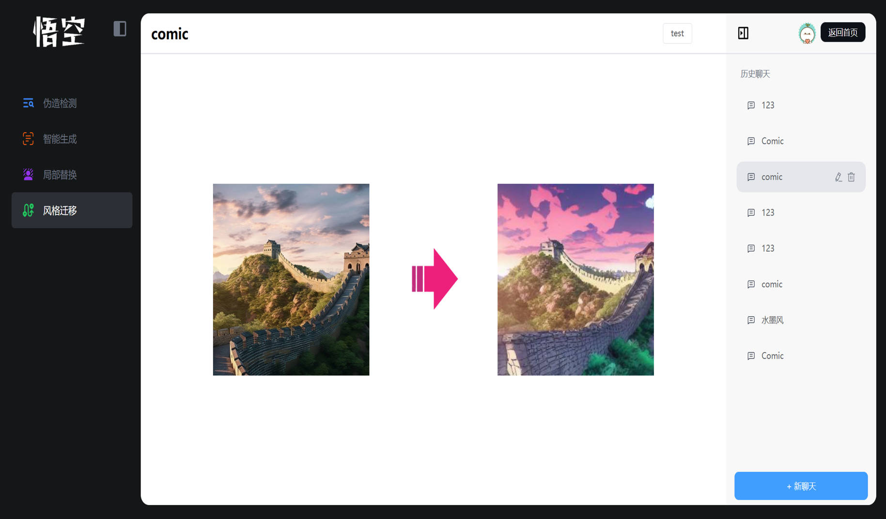
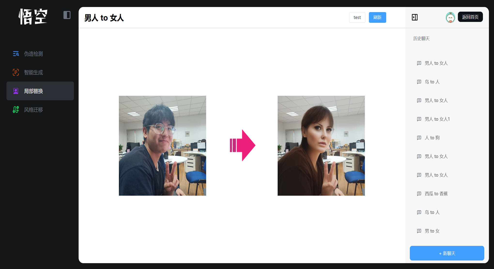
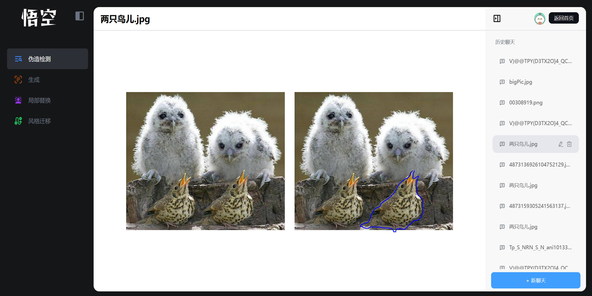
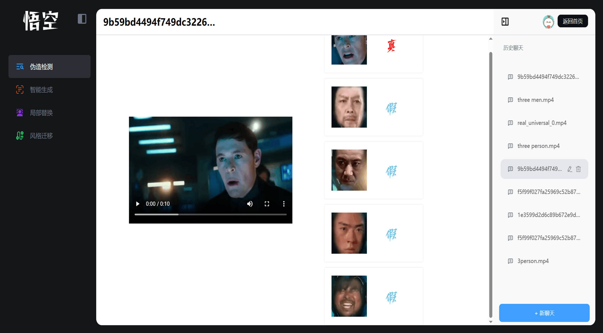
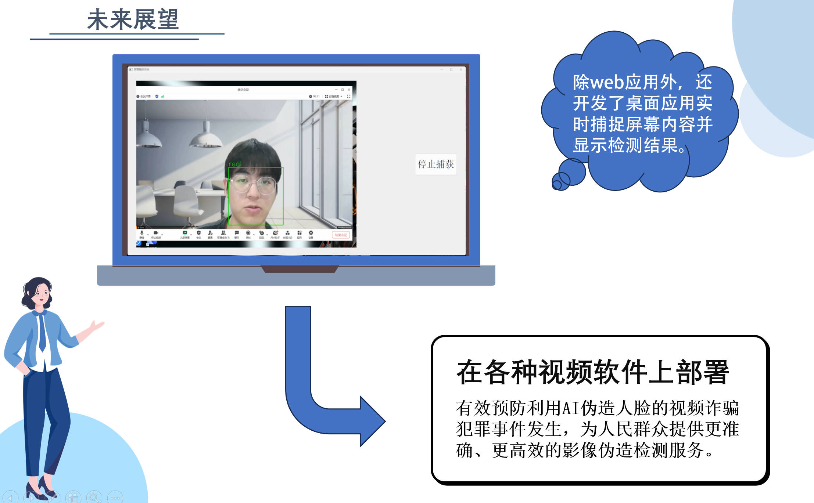

# 悟空智能

中文 | [English](./README.md)

> ✨ 让创作抵达更远的地方，也让每一帧影像更值得信任。

**悟空智能**围绕两种彼此呼应的能力展开：**“七十二变”**让更多人能够进行跨模态影像创作与编辑；**“火眼金睛”**则帮助人们判断影像是否可信。

AIGC 让想象拥有了更普惠的视觉表达，也让合成面孔、篡改影像更容易脱离语境传播。为此，我们将多种专项检测模型整合为可落地的服务：识别全局 AIGC 内容、人脸伪造与局部 PS 篡改，并为图像与视频的可信使用提供一层审慎而可靠的守护。

## 项目荣誉

该项目荣获：

- 第二十六届中国机器人及人工智能大赛江苏赛区省级一等奖

  

- 第二十六届中国机器人及人工智能大赛全国总决赛国家一等奖

  

本仓库是悟空智能的检测模块后端模型代码，主要功能是提供对多种伪造类型的检测，包括“七十二变”生成、PS 篡改和人脸伪造，使用 Flask 框架开发并自行本地化部署模型。

配套的 Vue 3 前端仓库：[wukong-frontEnd](https://github.com/YueTwo/wukong-frontEnd)。

## 核心能力

- **多维伪造检测**：面向全局 AIGC、人物面部伪造与 PS/局部篡改，匹配相应检测能力。
- **兼顾图像与视频**：服务于悟空智能网页端所呈现的多媒体检测流程。
- **篡改区域可视化**：支持 PS 篡改检测及区域定位，让判断结果更直观。
- **面向服务集成**：基于 Flask 接收转发请求，从阿里云 OSS 获取媒体资源，调用模型并返回检测结果。

## 网页效果展示

悟空智能让创作与验证并肩而行：“七十二变”将视觉灵感化为内容，“火眼金睛”则邀请用户在传播之前多一份洞察与判断。

### 七十二变 · 跨模态创作

| 文本指示下的影像/视频创作 | 文本指示下的风格迁移 |
| :---: | :---: |
|  |  |

| 文本指示下的目标替换 |
| :---: |
|  |

### 火眼金睛 · 伪造检测

| PS 图像篡改区域可视化 | 全局 AIGC 图片/视频检测 |
| :---: | :---: |
|  |  |

| 多人脸影像的伪造检测 |
| :---: |
|  |

## 仓库结构

```text
DetectionCode/
├── FakeImageDetection-master/  # 全局伪造 / AIGC 图像检测
├── HDIL/                       # 人脸伪造检测
├── IML-ViT-main/               # PS 篡改检测与可视化
├── flask/                      # Flask 服务与请求处理层
└── images/                     # 架构图、获奖证明与网页效果图
```

## 系统概览

### 功能总览


### 系统架构


### 开发框架


## 关于未来

我们期待可信影像工具能更贴近人们沟通与分享的现场：实时视频、社交内容，以及每一次日常传播。技术不应削弱创作的可能，而应让人们更容易识别操纵、远离影像与人脸伪造诈骗，在想象力与安全感之间拥有更从容的选择。


